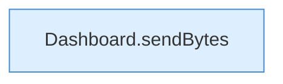

[[00 Start]] › [[Dashboard-HTTP]] › [[API-Antworten]] › [[Dashboard.send]]

# Dashboard.send

`Dashboard.send(HttpExchange ex, int code, String type, String s)` [src/main/java/de/aichele/childlauncher/Dashboard.java:998–998](https://github.com/Sciddie/minecraft-serverhoster-plugin/blob/95b02b953b0b4c23673e900e021a7c3c844aa37d/src/main/java/de/aichele/childlauncher/Dashboard.java#L998-L998)

- `send` in `src/main/java/de/aichele/childlauncher/Dashboard.java`
