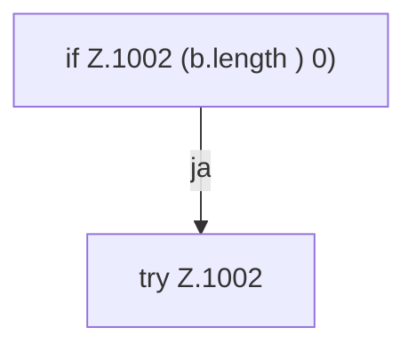

[[00 Start]] › [[Dashboard-HTTP]] › [[API-Antworten]] › [[Dashboard.sendBytes]]

# Dashboard.sendBytes

`Dashboard.sendBytes(HttpExchange ex, int code, String type, byte[] b)` [src/main/java/de/aichele/childlauncher/Dashboard.java:999–1003](https://github.com/Sciddie/minecraft-serverhoster-plugin/blob/95b02b953b0b4c23673e900e021a7c3c844aa37d/src/main/java/de/aichele/childlauncher/Dashboard.java#L999-L1003)



```knoten
if Z.1002 (b.length ) 0)
  Hier fällt eine Entscheidung. Nur wenn sie zutrifft, geht es den Ja-Weg weiter. Das steht in [[Glossar#Zeile|Zeile]] 1002.
try Z.1002
  Das Programm versucht diesen Schritt. Geht er schief, führt der andere Weg weiter. Das steht in [[Glossar#Zeile|Zeile]] 1002.
```

> [!knoten]- Was die Blöcke tun
> - **if Z.1002 (b.length ) 0)**: Hier fällt eine Entscheidung. Nur wenn sie zutrifft, geht es den Ja-Weg weiter. Das steht in [[Glossar#Zeile|Zeile]] 1002.
> - **try Z.1002**: Das Programm versucht diesen Schritt. Geht er schief, führt der andere Weg weiter. Das steht in [[Glossar#Zeile|Zeile]] 1002.

- Die [[Glossar#Web-Schnittstelle|Web-Schnittstelle]] schickt die Größe.
