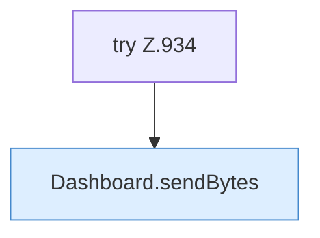

[[00 Start]] › [[Dashboard-HTTP]] › [[HTTP-Routing]] › [[Dashboard.serveIndex]]

# Dashboard.serveIndex

`Dashboard.serveIndex(HttpExchange ex)` [src/main/java/de/aichele/childlauncher/Dashboard.java:933–940](https://github.com/Sciddie/minecraft-serverhoster-plugin/blob/95b02b953b0b4c23673e900e021a7c3c844aa37d/src/main/java/de/aichele/childlauncher/Dashboard.java#L933-L940)

- `serveIndex` in `src/main/java/de/aichele/childlauncher/Dashboard.java`
