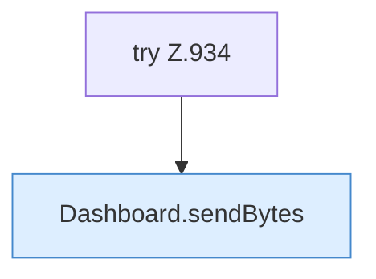

[[00 Start]] › [[Dashboard-HTTP]] › [[HTTP-Routing]] › [[Dashboard.serveIndex]]

# Dashboard.serveIndex

`Dashboard.serveIndex(HttpExchange ex)` [src/main/java/de/aichele/childlauncher/Dashboard.java:933–940](https://github.com/Sciddie/minecraft-serverhoster-plugin/blob/95b02b953b0b4c23673e900e021a7c3c844aa37d/src/main/java/de/aichele/childlauncher/Dashboard.java#L933-L940)



```knoten
try Z.934
  Das Programm versucht diesen Schritt. Geht er schief, führt der andere Weg weiter. Das steht in [[Glossar#Zeile|Zeile]] 934.
Dashboard.sendBytes
  Die [[Glossar#Web-Schnittstelle|Web-Schnittstelle]] schickt die Größe. Im [[Glossar#Quelltext|Quelltext]] heißt das `sendBytes`.
```

> [!knoten]- Was die Blöcke tun
> - **try Z.934**: Das Programm versucht diesen Schritt. Geht er schief, führt der andere Weg weiter. Das steht in [[Glossar#Zeile|Zeile]] 934.
> - **Dashboard.sendBytes**: Die [[Glossar#Web-Schnittstelle|Web-Schnittstelle]] schickt die Größe. Im [[Glossar#Quelltext|Quelltext]] heißt das `sendBytes`.

- Die [[Glossar#Web-Schnittstelle|Web-Schnittstelle]] liefert die Position.
