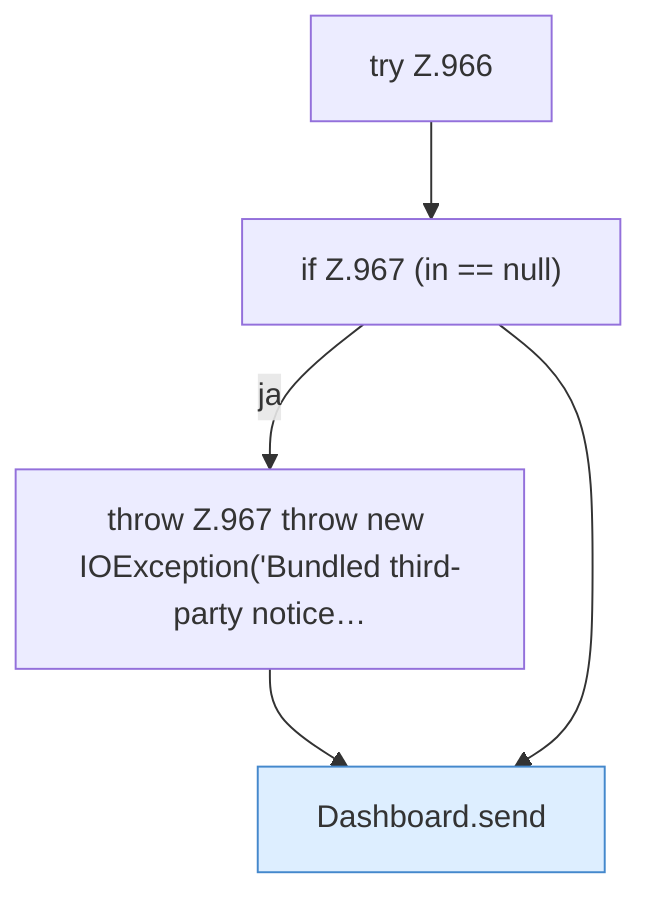

[[00 Start]] › [[Dashboard-HTTP]] › [[HTTP-Routing]] › [[Dashboard.serveThirdPartyNotices]]

# Dashboard.serveThirdPartyNotices

`Dashboard.serveThirdPartyNotices(HttpExchange ex)` [src/main/java/de/aichele/childlauncher/Dashboard.java:965–970](https://github.com/Sciddie/minecraft-serverhoster-plugin/blob/95b02b953b0b4c23673e900e021a7c3c844aa37d/src/main/java/de/aichele/childlauncher/Dashboard.java#L965-L970)



```knoten
try Z.966
  Zeile 966: Versuch. Der Fehlerpfad geht in catch.
if Z.967 (in == null)
  Zeile 967: prüft `(in == null)`.
throw Z.967 throw new IOException('Bundled third-party notice…
  Zeile 967: Abbruch `throw new IOException('Bundled third-party notice…`.
Dashboard.send
  Sendet `send`. Ruft `sendBytes`.
```

- `serveThirdPartyNotices` in `src/main/java/de/aichele/childlauncher/Dashboard.java`
