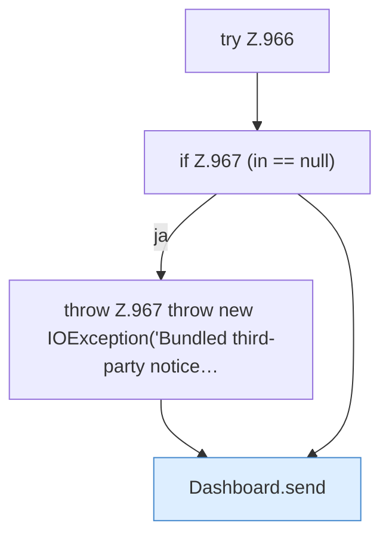

[[00 Start]] › [[Dashboard-HTTP]] › [[HTTP-Routing]] › [[Dashboard.serveThirdPartyNotices]]

# Dashboard.serveThirdPartyNotices

`Dashboard.serveThirdPartyNotices(HttpExchange ex)` [src/main/java/de/aichele/childlauncher/Dashboard.java:965–970](https://github.com/Sciddie/minecraft-serverhoster-plugin/blob/95b02b953b0b4c23673e900e021a7c3c844aa37d/src/main/java/de/aichele/childlauncher/Dashboard.java#L965-L970)



```knoten
try Z.966
  Das Programm versucht diesen Schritt. Geht er schief, führt der andere Weg weiter. Das steht in [[Glossar#Zeile|Zeile]] 966.
if Z.967 (in == null)
  Hier fällt eine Entscheidung. Nur wenn sie zutrifft, geht es den Ja-Weg weiter. Das steht in [[Glossar#Zeile|Zeile]] 967.
throw Z.967 throw new IOException('Bundled third-party notice…
  Hier bricht die [[Glossar#Funktion|Funktion]] ab, weil etwas nicht geklappt hat. Das steht in [[Glossar#Zeile|Zeile]] 967.
Dashboard.send
  Schickt die Antwort an den Browser. Im [[Glossar#Quelltext|Quelltext]] heißt das `send`.
```

> [!knoten]- Was die Blöcke tun
> - **try Z.966**: Das Programm versucht diesen Schritt. Geht er schief, führt der andere Weg weiter. Das steht in [[Glossar#Zeile|Zeile]] 966.
> - **if Z.967 (in == null)**: Hier fällt eine Entscheidung. Nur wenn sie zutrifft, geht es den Ja-Weg weiter. Das steht in [[Glossar#Zeile|Zeile]] 967.
> - **throw Z.967 throw new IOException('Bundled third-party notice…**: Hier bricht die [[Glossar#Funktion|Funktion]] ab, weil etwas nicht geklappt hat. Das steht in [[Glossar#Zeile|Zeile]] 967.
> - **Dashboard.send**: Schickt die Antwort an den Browser. Im [[Glossar#Quelltext|Quelltext]] heißt das `send`.

- Die [[Glossar#Web-Schnittstelle|Web-Schnittstelle]] liefert fremde Bausteine die Hinweise.
