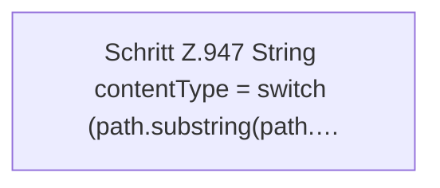

[[00 Start]] › [[Dashboard-HTTP]] › [[HTTP-Routing]] › [[Dashboard.serveWebAsset]] › [[Dashboard.serveWebAsset.Z947]]

# Dashboard.serveWebAsset.Z947



```knoten
Schritt Z.947 String contentType = switch (path.substring(path.…
  Zeile 947: `String contentType = switch (path.substring(path.…`
```

> [!knoten]- Was die Blöcke tun
> - **Schritt Z.947 String contentType = switch (path.substring(path.…**: Zeile 947: `String contentType = switch (path.substring(path.…`

- Der Ablauf geht in [[Glossar#Zeile|Zeile]] 947 weiter. Eine Ebene tiefer steht er genauer.
- Fortsetzung von `Dashboard.serveWebAsset`.
