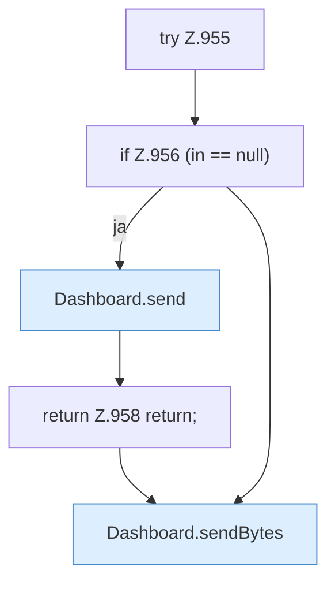

[[00 Start]] › [[Dashboard-HTTP]] › [[HTTP-Routing]] › [[Dashboard.serveWebAsset]] › [[Dashboard.serveWebAsset.Z955]]

# Dashboard.serveWebAsset.Z955

- Fortsetzung von `Dashboard.serveWebAsset`, Quellreihenfolge.
