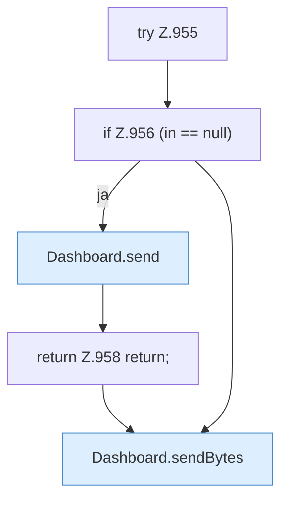

[[00 Start]] › [[Dashboard-HTTP]] › [[HTTP-Routing]] › [[Dashboard.serveWebAsset]] › [[Dashboard.serveWebAsset.Z955]]

# Dashboard.serveWebAsset.Z955



```knoten
try Z.955
  Zeile 955: Versuch. Der Fehlerpfad geht in catch.
if Z.956 (in == null)
  Zeile 956: prüft `(in == null)`.
Dashboard.send
  Schickt die Antwort an den Browser. Sendet `send`. Ruft `sendBytes`.
return Z.958 return;
  Zeile 958: Rückgabe `return;`.
Dashboard.sendBytes
  Die [[Glossar#Web-Schnittstelle|Web-Schnittstelle]] schickt die Größe. Sendet `sendBytes`.
```

> [!knoten]- Was die Blöcke tun
> - **try Z.955**: Zeile 955: Versuch. Der Fehlerpfad geht in catch.
> - **if Z.956 (in == null)**: Zeile 956: prüft `(in == null)`.
> - **Dashboard.send**: Schickt die Antwort an den Browser. Sendet `send`. Ruft `sendBytes`.
> - **return Z.958 return;**: Zeile 958: Rückgabe `return;`.
> - **Dashboard.sendBytes**: Die [[Glossar#Web-Schnittstelle|Web-Schnittstelle]] schickt die Größe. Sendet `sendBytes`.

- Der Ablauf geht in [[Glossar#Zeile|Zeile]] 955 weiter. Eine Ebene tiefer steht er genauer.
- Fortsetzung von `Dashboard.serveWebAsset`.
