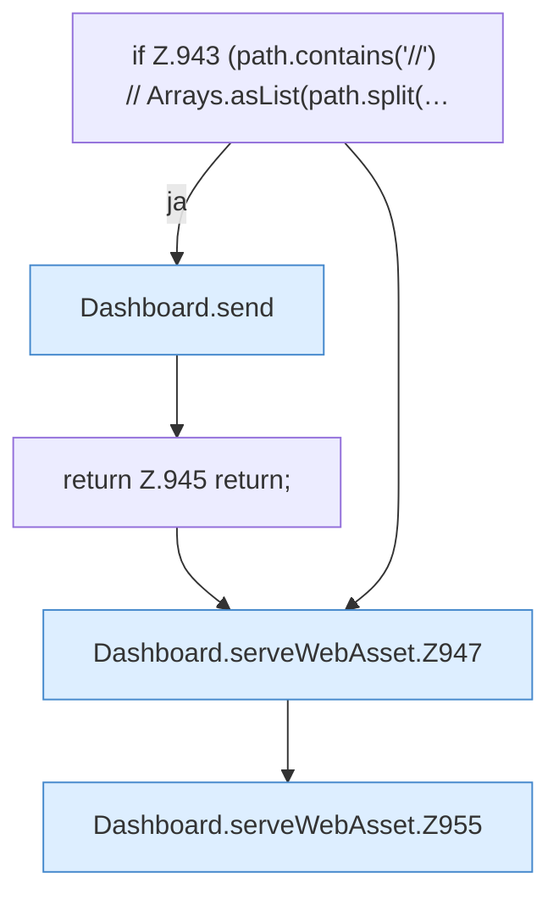

[[00 Start]] › [[Dashboard-HTTP]] › [[HTTP-Routing]] › [[Dashboard.serveWebAsset]]

# Dashboard.serveWebAsset

`Dashboard.serveWebAsset(HttpExchange ex, String path)` [src/main/java/de/aichele/childlauncher/Dashboard.java:942–963](https://github.com/Sciddie/minecraft-serverhoster-plugin/blob/95b02b953b0b4c23673e900e021a7c3c844aa37d/src/main/java/de/aichele/childlauncher/Dashboard.java#L942-L963)

- `serveWebAsset` in `src/main/java/de/aichele/childlauncher/Dashboard.java`
