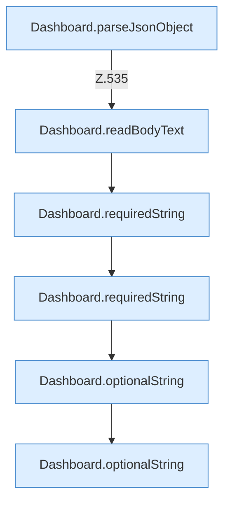

[[00 Start]] › [[Dashboard-HTTP]] › [[API-Setup]] › [[Dashboard.setup]] › [[Dashboard.setup.Teil1]]

# Dashboard.setup.Teil1



```knoten
Dashboard.parseJsonObject
  Die [[Glossar#Web-Schnittstelle|Web-Schnittstelle]] liest die Antwort den Inhalt. Wertet aus `parseJsonObject`.
Dashboard.readBodyText
  Die [[Glossar#Web-Schnittstelle|Web-Schnittstelle]] liest den Text den Text. Liest `readBodyText`.
Dashboard.requiredString
  Liest einen Text, der in der Anfrage dabei sein muss. Liest verpflichtend `requiredString`.
Dashboard.optionalString
  Liest einen Text, der in der Anfrage fehlen darf. Liest optional `optionalString`.
```

> [!knoten]- Was die Blöcke tun
> - **Dashboard.parseJsonObject**: Die [[Glossar#Web-Schnittstelle|Web-Schnittstelle]] liest die Antwort den Inhalt. Wertet aus `parseJsonObject`.
> - **Dashboard.readBodyText**: Die [[Glossar#Web-Schnittstelle|Web-Schnittstelle]] liest den Text den Text. Liest `readBodyText`.
> - **Dashboard.requiredString**: Liest einen Text, der in der Anfrage dabei sein muss. Liest verpflichtend `requiredString`.
> - **Dashboard.optionalString**: Liest einen Text, der in der Anfrage fehlen darf. Liest optional `optionalString`.

- Ein weiterer Abschnitt derselben Übersicht.
- Fortsetzung von `Dashboard.setup`.
