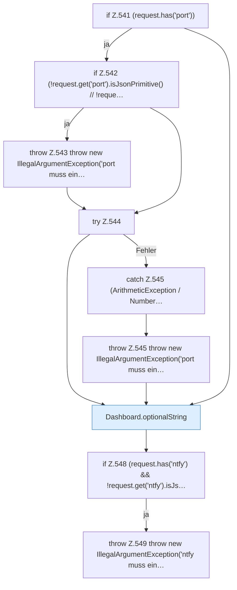

[[00 Start]] › [[Dashboard-HTTP]] › [[API-Setup]] › [[Dashboard.setup]] › [[Dashboard.setup.Teil2]]

# Dashboard.setup.Teil2



```knoten
if Z.541 (request.has('port'))
  Zeile 541: prüft `(request.has('port'))`.
if Z.542 (!request.get('port').isJsonPrimitive() // !reque…
  Zeile 542: prüft `(!request.get('port').isJsonPrimitive() // !reque…`.
throw Z.543 throw new IllegalArgumentException('port muss ein…
  Zeile 543: Abbruch `throw new IllegalArgumentException('port muss ein…`.
try Z.544
  Zeile 544: Versuch. Der Fehlerpfad geht in catch.
catch Z.545 (ArithmeticException / Number…
  Zeile 545: fängt (ArithmeticException / Number….
throw Z.545 throw new IllegalArgumentException('port muss ein…
  Zeile 545: Abbruch `throw new IllegalArgumentException('port muss ein…`.
Dashboard.optionalString
  Liest einen Text, der in der Anfrage fehlen darf. Liest optional `optionalString`.
if Z.548 (request.has('ntfy') && !request.get('ntfy').isJs…
  Zeile 548: prüft `(request.has('ntfy') && !request.get('ntfy').isJs…`.
throw Z.549 throw new IllegalArgumentException('ntfy muss ein…
  Zeile 549: Abbruch `throw new IllegalArgumentException('ntfy muss ein…`.
```

> [!knoten]- Was die Blöcke tun
> - **if Z.541 (request.has('port'))**: Zeile 541: prüft `(request.has('port'))`.
> - **if Z.542 (!request.get('port').isJsonPrimitive() // !reque…**: Zeile 542: prüft `(!request.get('port').isJsonPrimitive() // !reque…`.
> - **throw Z.543 throw new IllegalArgumentException('port muss ein…**: Zeile 543: Abbruch `throw new IllegalArgumentException('port muss ein…`.
> - **try Z.544**: Zeile 544: Versuch. Der Fehlerpfad geht in catch.
> - **catch Z.545 (ArithmeticException / Number…**: Zeile 545: fängt (ArithmeticException / Number….
> - **throw Z.545 throw new IllegalArgumentException('port muss ein…**: Zeile 545: Abbruch `throw new IllegalArgumentException('port muss ein…`.
> - **Dashboard.optionalString**: Liest einen Text, der in der Anfrage fehlen darf. Liest optional `optionalString`.
> - **if Z.548 (request.has('ntfy') && !request.get('ntfy').isJs…**: Zeile 548: prüft `(request.has('ntfy') && !request.get('ntfy').isJs…`.
> - **throw Z.549 throw new IllegalArgumentException('ntfy muss ein…**: Zeile 549: Abbruch `throw new IllegalArgumentException('ntfy muss ein…`.

- Ein weiterer Abschnitt derselben Übersicht.
- Fortsetzung von `Dashboard.setup`.
