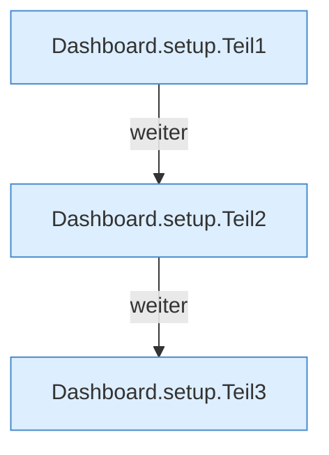

[[00 Start]] › [[Dashboard-HTTP]] › [[API-Setup]] › [[Dashboard.setup]]

# Dashboard.setup

`Dashboard.setup(HttpExchange ex)` [src/main/java/de/aichele/childlauncher/Dashboard.java:534–560](https://github.com/Sciddie/minecraft-serverhoster-plugin/blob/95b02b953b0b4c23673e900e021a7c3c844aa37d/src/main/java/de/aichele/childlauncher/Dashboard.java#L534-L560)

- `setup` in `src/main/java/de/aichele/childlauncher/Dashboard.java`
