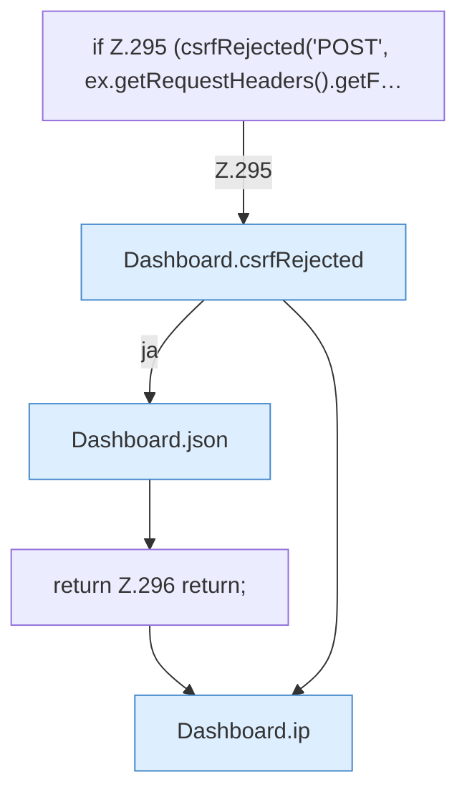

[[00 Start]] › [[Dashboard-HTTP]] › [[HTTP-Auth]] › [[Dashboard.setupPassword]] › [[Dashboard.setupPassword.Teil1]]

# Dashboard.setupPassword.Teil1

- Fortsetzung von `Dashboard.setupPassword`, Quellreihenfolge.
