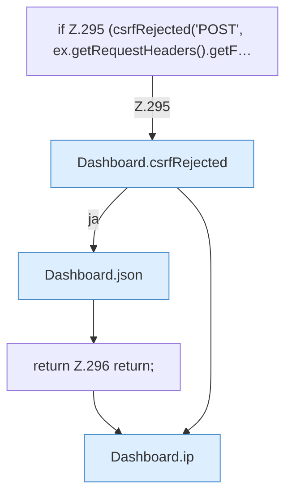

[[00 Start]] › [[Dashboard-HTTP]] › [[HTTP-Auth]] › [[Dashboard.setupPassword]] › [[Dashboard.setupPassword.Teil1]]

# Dashboard.setupPassword.Teil1



```knoten
if Z.295 (csrfRejected('POST', ex.getRequestHeaders().getF…
  Zeile 295: prüft `(csrfRejected('POST', ex.getRequestHeaders().getF…`.
Dashboard.csrfRejected
  Lehnt eine Anfrage ab, die nicht von der eigenen [[Glossar#Bedienseite|Bedienseite]] kommt. `csrfRejected` in `Dashboard.java`.
Dashboard.json
  Die [[Glossar#Web-Schnittstelle|Web-Schnittstelle]] macht hier einen einzelnen Schritt. Eine Ebene tiefer steht er genauer. Antwortet mit JSON `json`. Ruft `sendBytes`.
return Z.296 return;
  Zeile 296: Rückgabe `return;`.
Dashboard.ip
  Die [[Glossar#Web-Schnittstelle|Web-Schnittstelle]] macht hier einen einzelnen Schritt. Eine Ebene tiefer steht er genauer. `ip` in `Dashboard.java`.
```

> [!knoten]- Was die Blöcke tun
> - **if Z.295 (csrfRejected('POST', ex.getRequestHeaders().getF…**: Zeile 295: prüft `(csrfRejected('POST', ex.getRequestHeaders().getF…`.
> - **Dashboard.csrfRejected**: Lehnt eine Anfrage ab, die nicht von der eigenen [[Glossar#Bedienseite|Bedienseite]] kommt. `csrfRejected` in `Dashboard.java`.
> - **Dashboard.json**: Die [[Glossar#Web-Schnittstelle|Web-Schnittstelle]] macht hier einen einzelnen Schritt. Eine Ebene tiefer steht er genauer. Antwortet mit JSON `json`. Ruft `sendBytes`.
> - **return Z.296 return;**: Zeile 296: Rückgabe `return;`.
> - **Dashboard.ip**: Die [[Glossar#Web-Schnittstelle|Web-Schnittstelle]] macht hier einen einzelnen Schritt. Eine Ebene tiefer steht er genauer. `ip` in `Dashboard.java`.

- Ein weiterer Abschnitt derselben Übersicht.
- Fortsetzung von `Dashboard.setupPassword`.
