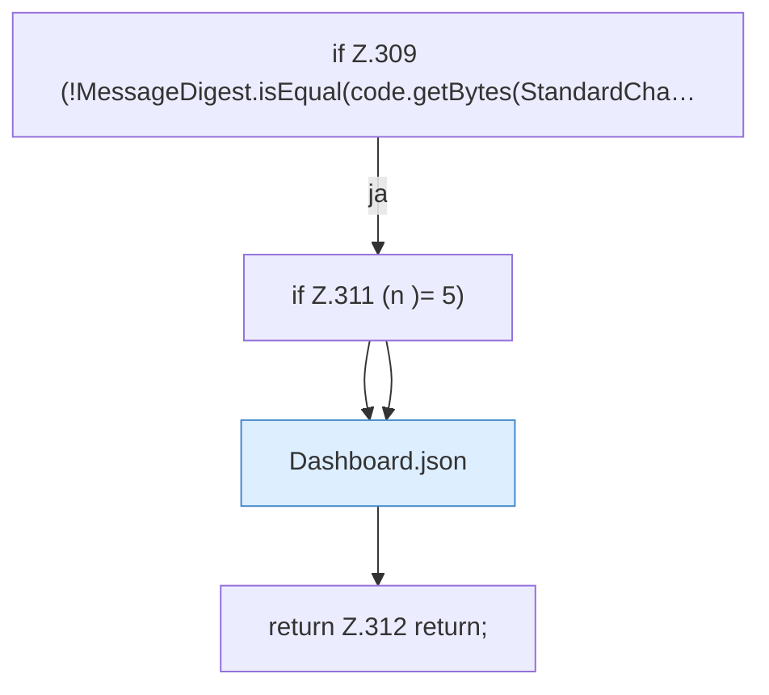

[[00 Start]] › [[Dashboard-HTTP]] › [[HTTP-Auth]] › [[Dashboard.setupPassword]] › [[Dashboard.setupPassword.Teil2.Z304.Teil1.Z309]]

# Dashboard.setupPassword.Teil2.Z304.Teil1.Z309



```knoten
if Z.309 (!MessageDigest.isEqual(code.getBytes(StandardCha…
  Zeile 309: prüft `(!MessageDigest.isEqual(code.getBytes(StandardCha…`.
if Z.311 (n )= 5)
  Zeile 311: prüft `(n )= 5)`.
Dashboard.json
  Die [[Glossar#Web-Schnittstelle|Web-Schnittstelle]] macht hier einen einzelnen Schritt. Eine Ebene tiefer steht er genauer. Antwortet mit JSON `json`. Ruft `sendBytes`.
return Z.312 return;
  Zeile 312: Rückgabe `return;`.
```

> [!knoten]- Was die Blöcke tun
> - **if Z.309 (!MessageDigest.isEqual(code.getBytes(StandardCha…**: Zeile 309: prüft `(!MessageDigest.isEqual(code.getBytes(StandardCha…`.
> - **if Z.311 (n )= 5)**: Zeile 311: prüft `(n )= 5)`.
> - **Dashboard.json**: Die [[Glossar#Web-Schnittstelle|Web-Schnittstelle]] macht hier einen einzelnen Schritt. Eine Ebene tiefer steht er genauer. Antwortet mit JSON `json`. Ruft `sendBytes`.
> - **return Z.312 return;**: Zeile 312: Rückgabe `return;`.

- Der Ablauf geht in [[Glossar#Zeile|Zeile]] 309 weiter. Eine Ebene tiefer steht er genauer.
- Fortsetzung von `Dashboard.setupPassword.Teil2.Z304.Teil1`.
