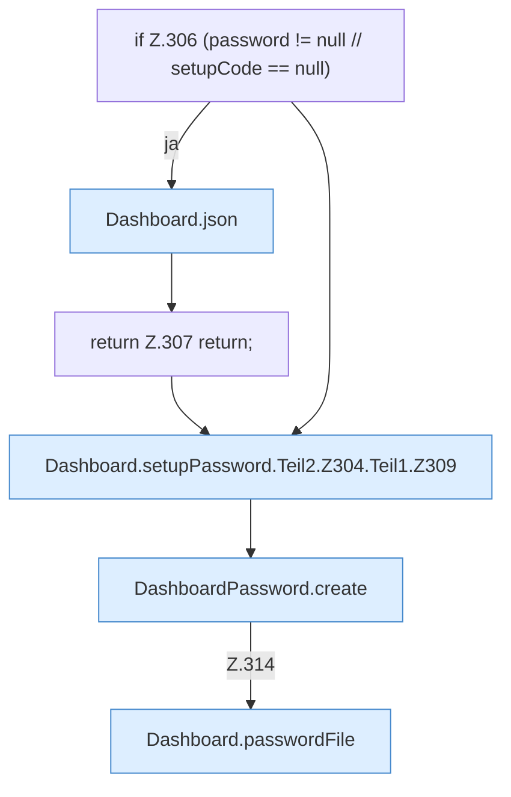

[[00 Start]] › [[Dashboard-HTTP]] › [[HTTP-Auth]] › [[Dashboard.setupPassword]] › [[Dashboard.setupPassword.Teil2.Z304.Teil1]]

# Dashboard.setupPassword.Teil2.Z304.Teil1



```knoten
if Z.306 (password != null // setupCode == null)
  Zeile 306: prüft `(password != null // setupCode == null)`.
Dashboard.json
  Die [[Glossar#Web-Schnittstelle|Web-Schnittstelle]] macht hier einen einzelnen Schritt. Eine Ebene tiefer steht er genauer. Antwortet mit JSON `json`. Ruft `sendBytes`.
return Z.307 return;
  Zeile 307: Rückgabe `return;`.
Dashboard.setupPassword.Teil2.Z304.Teil1.Z309
  Der Ablauf geht in [[Glossar#Zeile|Zeile]] 309 weiter. Eine Ebene tiefer steht er genauer. Fortsetzung des Ablaufs ab Zeile 309.
DashboardPassword.create
  Dieser Teil legt an das. Legt an `create`.
Dashboard.passwordFile
  Liest oder schreibt die Datei mit dem Passwort der [[Glossar#Bedienseite|Bedienseite]]. `passwordFile` in `Dashboard.java`.
```

> [!knoten]- Was die Blöcke tun
> - **if Z.306 (password != null // setupCode == null)**: Zeile 306: prüft `(password != null // setupCode == null)`.
> - **Dashboard.json**: Die [[Glossar#Web-Schnittstelle|Web-Schnittstelle]] macht hier einen einzelnen Schritt. Eine Ebene tiefer steht er genauer. Antwortet mit JSON `json`. Ruft `sendBytes`.
> - **return Z.307 return;**: Zeile 307: Rückgabe `return;`.
> - **Dashboard.setupPassword.Teil2.Z304.Teil1.Z309**: Der Ablauf geht in [[Glossar#Zeile|Zeile]] 309 weiter. Eine Ebene tiefer steht er genauer. Fortsetzung des Ablaufs ab Zeile 309.
> - **DashboardPassword.create**: Dieser Teil legt an das. Legt an `create`.
> - **Dashboard.passwordFile**: Liest oder schreibt die Datei mit dem Passwort der [[Glossar#Bedienseite|Bedienseite]]. `passwordFile` in `Dashboard.java`.

- Ein weiterer Abschnitt derselben Übersicht.
- Fortsetzung von `Dashboard.setupPassword.Teil2.Z304`.
