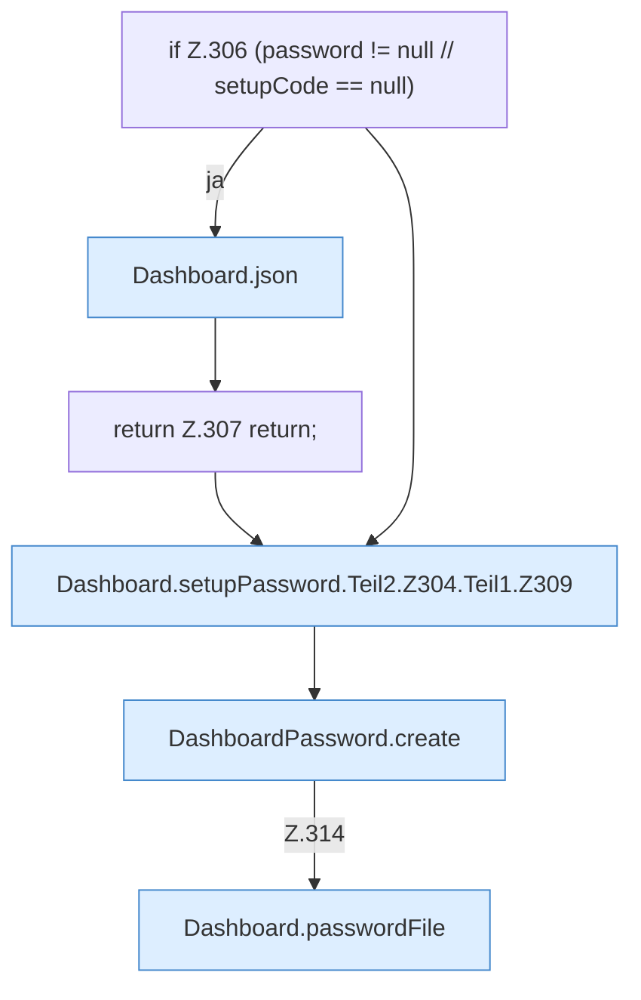

[[00 Start]] › [[Dashboard-HTTP]] › [[HTTP-Auth]] › [[Dashboard.setupPassword]] › [[Dashboard.setupPassword.Teil2.Z304.Teil1]]

# Dashboard.setupPassword.Teil2.Z304.Teil1



```knoten
if Z.306 (password != null // setupCode == null)
  Zeile 306: prüft `(password != null // setupCode == null)`.
Dashboard.json
  Antwortet mit JSON `json`. Ruft `sendBytes`.
return Z.307 return;
  Zeile 307: Rückgabe `return;`.
Dashboard.setupPassword.Teil2.Z304.Teil1.Z309
  Fortsetzung des Ablaufs ab Zeile 309.
DashboardPassword.create
  Legt an `create`.
Dashboard.passwordFile
  `passwordFile` in `Dashboard.java`.
```

- Fortsetzung von `Dashboard.setupPassword.Teil2.Z304`, Quellreihenfolge.
