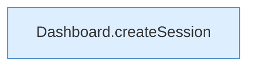

[[00 Start]] › [[Dashboard-HTTP]] › [[HTTP-Auth]] › [[Dashboard.setupPassword]] › [[Dashboard.setupPassword.Teil2.Z304.Teil2]]

# Dashboard.setupPassword.Teil2.Z304.Teil2



```knoten
Dashboard.createSession
  Die [[Glossar#Web-Schnittstelle|Web-Schnittstelle]] legt an die [[Glossar#Anmeldung|Anmeldung]]. Legt an `createSession`. Ruft `cookie`.
```

> [!knoten]- Was die Blöcke tun
> - **Dashboard.createSession**: Die [[Glossar#Web-Schnittstelle|Web-Schnittstelle]] legt an die [[Glossar#Anmeldung|Anmeldung]]. Legt an `createSession`. Ruft `cookie`.

- Ein weiterer Abschnitt derselben Übersicht.
- Fortsetzung von `Dashboard.setupPassword.Teil2.Z304`.
