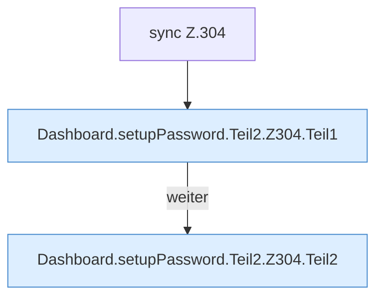

[[00 Start]] › [[Dashboard-HTTP]] › [[HTTP-Auth]] › [[Dashboard.setupPassword]] › [[Dashboard.setupPassword.Teil2.Z304]]

# Dashboard.setupPassword.Teil2.Z304

- Fortsetzung von `Dashboard.setupPassword.Teil2`, Quellreihenfolge.
