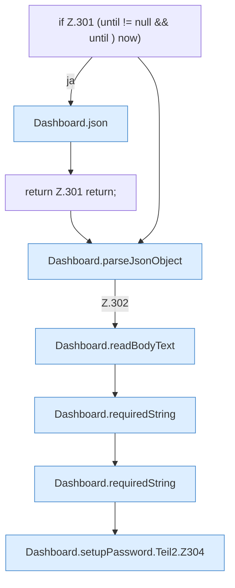

[[00 Start]] › [[Dashboard-HTTP]] › [[HTTP-Auth]] › [[Dashboard.setupPassword]] › [[Dashboard.setupPassword.Teil2]]

# Dashboard.setupPassword.Teil2



```knoten
if Z.301 (until != null && until ) now)
  Zeile 301: prüft `(until != null && until ) now)`.
Dashboard.json
  Die [[Glossar#Web-Schnittstelle|Web-Schnittstelle]] macht hier einen einzelnen Schritt. Eine Ebene tiefer steht er genauer. Antwortet mit JSON `json`. Ruft `sendBytes`.
return Z.301 return;
  Zeile 301: Rückgabe `return;`.
Dashboard.parseJsonObject
  Die [[Glossar#Web-Schnittstelle|Web-Schnittstelle]] liest die Antwort den Inhalt. Wertet aus `parseJsonObject`.
Dashboard.readBodyText
  Die [[Glossar#Web-Schnittstelle|Web-Schnittstelle]] liest den Text den Text. Liest `readBodyText`.
Dashboard.requiredString
  Liest einen Text, der in der Anfrage dabei sein muss. Liest verpflichtend `requiredString`.
Dashboard.setupPassword.Teil2.Z304
  Der Ablauf geht in [[Glossar#Zeile|Zeile]] 304 weiter. Eine Ebene tiefer steht er genauer. Fortsetzung des Ablaufs ab Zeile 304.
```

> [!knoten]- Was die Blöcke tun
> - **if Z.301 (until != null && until ) now)**: Zeile 301: prüft `(until != null && until ) now)`.
> - **Dashboard.json**: Die [[Glossar#Web-Schnittstelle|Web-Schnittstelle]] macht hier einen einzelnen Schritt. Eine Ebene tiefer steht er genauer. Antwortet mit JSON `json`. Ruft `sendBytes`.
> - **return Z.301 return;**: Zeile 301: Rückgabe `return;`.
> - **Dashboard.parseJsonObject**: Die [[Glossar#Web-Schnittstelle|Web-Schnittstelle]] liest die Antwort den Inhalt. Wertet aus `parseJsonObject`.
> - **Dashboard.readBodyText**: Die [[Glossar#Web-Schnittstelle|Web-Schnittstelle]] liest den Text den Text. Liest `readBodyText`.
> - **Dashboard.requiredString**: Liest einen Text, der in der Anfrage dabei sein muss. Liest verpflichtend `requiredString`.
> - **Dashboard.setupPassword.Teil2.Z304**: Der Ablauf geht in [[Glossar#Zeile|Zeile]] 304 weiter. Eine Ebene tiefer steht er genauer. Fortsetzung des Ablaufs ab Zeile 304.

- Ein weiterer Abschnitt derselben Übersicht.
- Fortsetzung von `Dashboard.setupPassword`.
