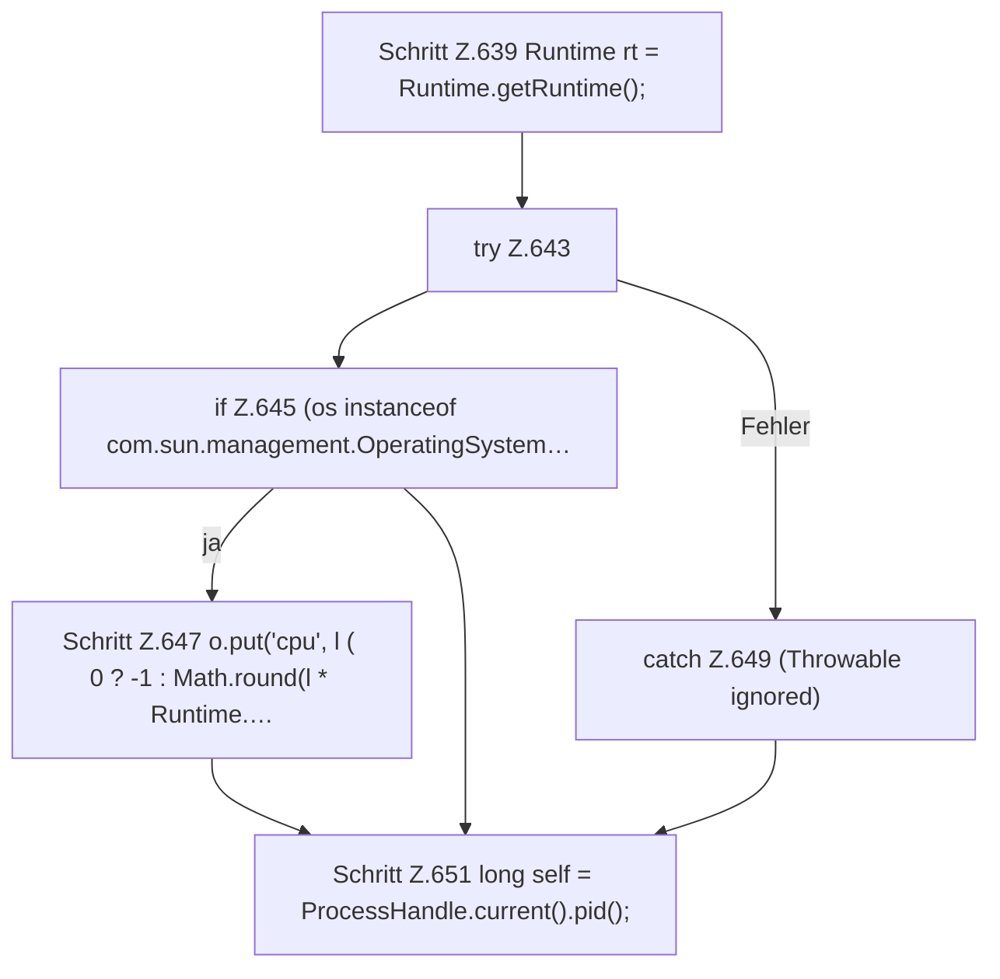

[[00 Start]] › [[Dashboard-HTTP]] › [[API-Status]] › [[Dashboard.spigotStats]] › [[Dashboard.spigotStats.Teil1]]

# Dashboard.spigotStats.Teil1



```knoten
Schritt Z.639 Runtime rt = Runtime.getRuntime();
  Zeile 639: fragt die JVM-Laufzeit. `Runtime rt = Runtime.getRuntime();`
try Z.643
  Zeile 643: Versuch. Der Fehlerpfad geht in catch.
if Z.645 (os instanceof com.sun.management.OperatingSystem…
  Zeile 645: prüft `(os instanceof com.sun.management.OperatingSystem…`.
Schritt Z.647 o.put('cpu', l ( 0 ? -1 : Math.round(l * Runtime.…
  Zeile 647: `o.put('cpu', l ( 0 ? -1 : Math.round(l * Runtime.…`
catch Z.649 (Throwable ignored)
  Zeile 649: fängt (Throwable ignored).
Schritt Z.651 long self = ProcessHandle.current().pid();
  Zeile 651: fragt den Prozess ab. `long self = ProcessHandle.current().pid();`
```

> [!knoten]- Was die Blöcke tun
> - **Schritt Z.639 Runtime rt = Runtime.getRuntime();**: Zeile 639: fragt die JVM-Laufzeit. `Runtime rt = Runtime.getRuntime();`
> - **try Z.643**: Zeile 643: Versuch. Der Fehlerpfad geht in catch.
> - **if Z.645 (os instanceof com.sun.management.OperatingSystem…**: Zeile 645: prüft `(os instanceof com.sun.management.OperatingSystem…`.
> - **Schritt Z.647 o.put('cpu', l ( 0 ? -1 : Math.round(l * Runtime.…**: Zeile 647: `o.put('cpu', l ( 0 ? -1 : Math.round(l * Runtime.…`
> - **catch Z.649 (Throwable ignored)**: Zeile 649: fängt (Throwable ignored).
> - **Schritt Z.651 long self = ProcessHandle.current().pid();**: Zeile 651: fragt den Prozess ab. `long self = ProcessHandle.current().pid();`

- Ein weiterer Abschnitt derselben Übersicht.
- Fortsetzung von `Dashboard.spigotStats`.
