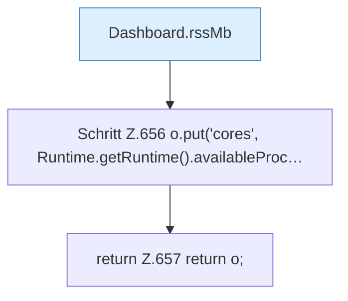

[[00 Start]] › [[Dashboard-HTTP]] › [[API-Status]] › [[Dashboard.spigotStats]] › [[Dashboard.spigotStats.Teil2]]

# Dashboard.spigotStats.Teil2

- Fortsetzung von `Dashboard.spigotStats`, Quellreihenfolge.
