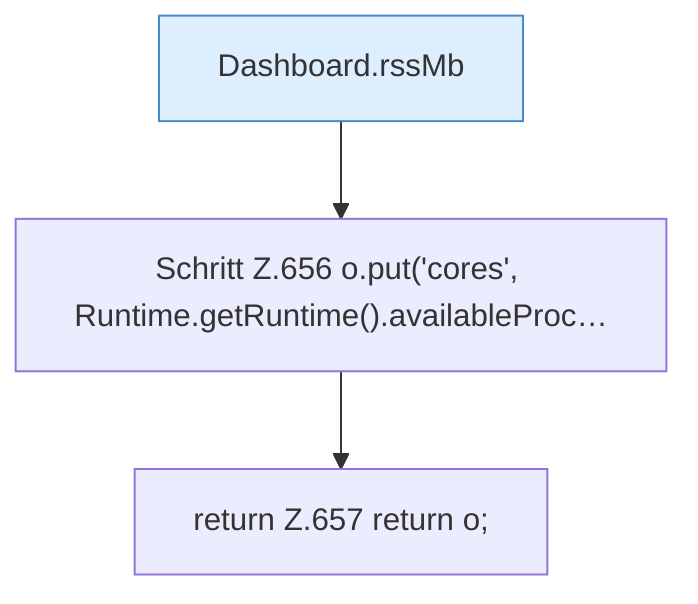

[[00 Start]] › [[Dashboard-HTTP]] › [[API-Status]] › [[Dashboard.spigotStats]] › [[Dashboard.spigotStats.Teil2]]

# Dashboard.spigotStats.Teil2



```knoten
Dashboard.rssMb
  Liest, wie viel [[Glossar#Arbeitsspeicher|Arbeitsspeicher]] der [[Glossar#Prozess|Prozess]] gerade belegt. `rssMb` in `Dashboard.java`.
Schritt Z.656 o.put('cores', Runtime.getRuntime().availableProc…
  Zeile 656: fragt die JVM-Laufzeit. `o.put('cores', Runtime.getRuntime().availableProc…`
return Z.657 return o;
  Zeile 657: Rückgabe `return o;`.
```

> [!knoten]- Was die Blöcke tun
> - **Dashboard.rssMb**: Liest, wie viel [[Glossar#Arbeitsspeicher|Arbeitsspeicher]] der [[Glossar#Prozess|Prozess]] gerade belegt. `rssMb` in `Dashboard.java`.
> - **Schritt Z.656 o.put('cores', Runtime.getRuntime().availableProc…**: Zeile 656: fragt die JVM-Laufzeit. `o.put('cores', Runtime.getRuntime().availableProc…`
> - **return Z.657 return o;**: Zeile 657: Rückgabe `return o;`.

- Ein weiterer Abschnitt derselben Übersicht.
- Fortsetzung von `Dashboard.spigotStats`.
