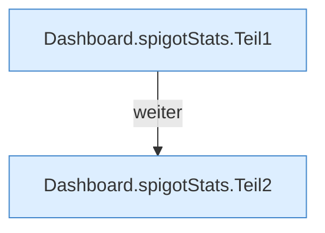

[[00 Start]] › [[Dashboard-HTTP]] › [[API-Status]] › [[Dashboard.spigotStats]]

# Dashboard.spigotStats

`Dashboard.spigotStats()` [src/main/java/de/aichele/childlauncher/Dashboard.java:637–658](https://github.com/Sciddie/minecraft-serverhoster-plugin/blob/95b02b953b0b4c23673e900e021a7c3c844aa37d/src/main/java/de/aichele/childlauncher/Dashboard.java#L637-L658)



```knoten
Dashboard.spigotStats.Teil1
  Ein weiterer Abschnitt derselben Übersicht. Im [[Glossar#Quelltext|Quelltext]] heißt das `Teil1`.
Dashboard.spigotStats.Teil2
  Ein weiterer Abschnitt derselben Übersicht. Im [[Glossar#Quelltext|Quelltext]] heißt das `Teil2`.
```

> [!knoten]- Was die Blöcke tun
> - **Dashboard.spigotStats.Teil1**: Ein weiterer Abschnitt derselben Übersicht. Im [[Glossar#Quelltext|Quelltext]] heißt das `Teil1`.
> - **Dashboard.spigotStats.Teil2**: Ein weiterer Abschnitt derselben Übersicht. Im [[Glossar#Quelltext|Quelltext]] heißt das `Teil2`.

- Liefert eine kurze Statistik, die der [[Glossar#Spielserver|Spielserver]] anbietet.
