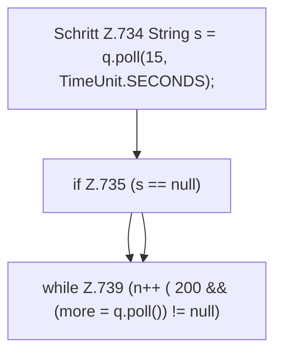

[[00 Start]] › [[Dashboard-HTTP]] › [[API-Status]] › [[Dashboard.sse]] › [[Dashboard.sse.Z729.Z733.Teil1]]

# Dashboard.sse.Z729.Z733.Teil1



```knoten
Schritt Z.734 String s = q.poll(15, TimeUnit.SECONDS);
  Zeile 734: rechnet Zeit um oder wartet. `String s = q.poll(15, TimeUnit.SECONDS);`
if Z.735 (s == null)
  Zeile 735: prüft `(s == null)`.
while Z.739 (n++ ( 200 && (more = q.poll()) != null)
  Zeile 739: Schleife `(n++ ( 200 && (more = q.poll()) != null)`.
```

- Fortsetzung von `Dashboard.sse.Z729.Z733`, Quellreihenfolge.
