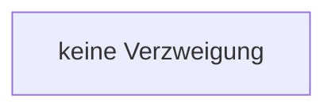

[[00 Start]] › [[Dashboard-HTTP]] › [[API-Status]] › [[Dashboard.sse]] › [[Dashboard.sse.Z729.Z733.Teil2]]

# Dashboard.sse.Z729.Z733.Teil2



```knoten
keine Verzweigung
  Schritt. `keine Verzweigung`
```

- Fortsetzung von `Dashboard.sse.Z729.Z733`, Quellreihenfolge.
