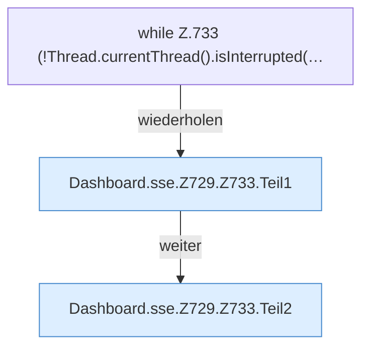

[[00 Start]] › [[Dashboard-HTTP]] › [[API-Status]] › [[Dashboard.sse]] › [[Dashboard.sse.Z729.Z733]]

# Dashboard.sse.Z729.Z733



```knoten
while Z.733 (!Thread.currentThread().isInterrupted(…
  Zeile 733: Schleife `(!Thread.currentThread().isInterrupted(…`.
Dashboard.sse.Z729.Z733.Teil1
  Ein weiterer Abschnitt derselben Übersicht. Abschnitt 1 dieses Ablaufs, in Quellreihenfolge.
Dashboard.sse.Z729.Z733.Teil2
  Ein weiterer Abschnitt derselben Übersicht. Abschnitt 2 dieses Ablaufs, in Quellreihenfolge.
```

> [!knoten]- Was die Blöcke tun
> - **while Z.733 (!Thread.currentThread().isInterrupted(…**: Zeile 733: Schleife `(!Thread.currentThread().isInterrupted(…`.
> - **Dashboard.sse.Z729.Z733.Teil1**: Ein weiterer Abschnitt derselben Übersicht. Abschnitt 1 dieses Ablaufs, in Quellreihenfolge.
> - **Dashboard.sse.Z729.Z733.Teil2**: Ein weiterer Abschnitt derselben Übersicht. Abschnitt 2 dieses Ablaufs, in Quellreihenfolge.

- Der Ablauf geht in [[Glossar#Zeile|Zeile]] 733 weiter. Eine Ebene tiefer steht er genauer.
- Fortsetzung von `Dashboard.sse.Z729`.
