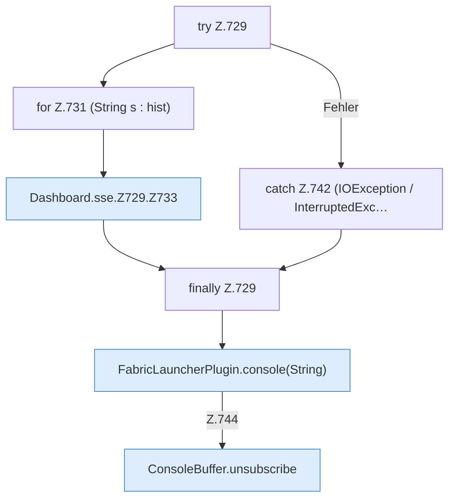

[[00 Start]] › [[Dashboard-HTTP]] › [[API-Status]] › [[Dashboard.sse]] › [[Dashboard.sse.Z729]]

# Dashboard.sse.Z729



```knoten
try Z.729
  Zeile 729: Versuch. Der Fehlerpfad geht in catch.
for Z.731 (String s : hist)
  Zeile 731: Schleife `(String s : hist)`.
Dashboard.sse.Z729.Z733
  Fortsetzung des Ablaufs ab Zeile 733.
catch Z.742 (IOException / InterruptedExc…
  Zeile 742: fängt (IOException / InterruptedExc….
finally Z.729
  Läuft danach immer, auch nach einem Fehler.
FabricLauncherPlugin.console(String)
  Liefert die Konsole `console`. Ruft `slot`.
ConsoleBuffer.unsubscribe
  Hängt den Hörer ab `unsubscribe`.
```

- Fortsetzung von `Dashboard.sse`, Quellreihenfolge.
