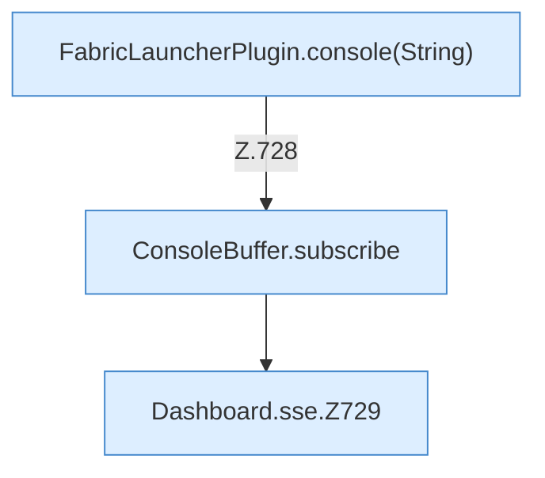
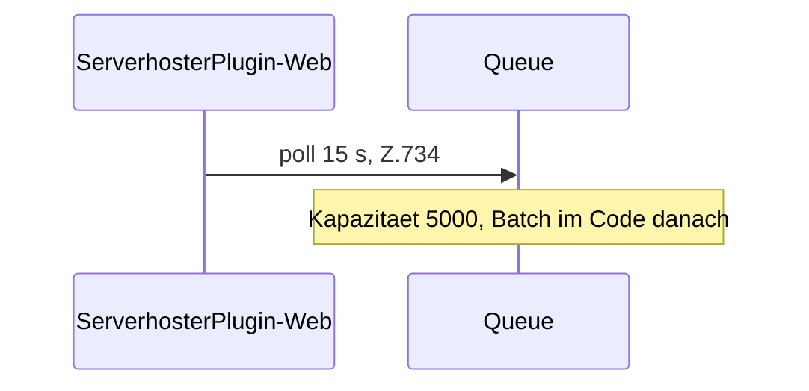

[[00 Start]] › [[Dashboard-HTTP]] › [[API-Status]] › [[Dashboard.sse]]

# Dashboard.sse

`Dashboard.sse(HttpExchange ex, String sid)` [src/main/java/de/aichele/childlauncher/Dashboard.java:722–746](https://github.com/Sciddie/minecraft-serverhoster-plugin/blob/95b02b953b0b4c23673e900e021a7c3c844aa37d/src/main/java/de/aichele/childlauncher/Dashboard.java#L722-L746)

- `sse` in `src/main/java/de/aichele/childlauncher/Dashboard.java`
