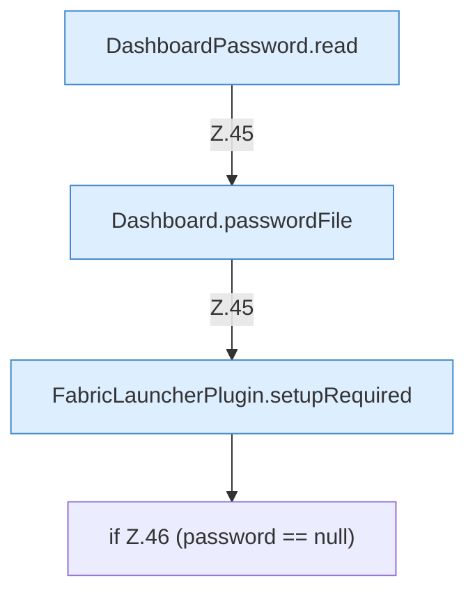

[[00 Start]] › [[Dashboard-HTTP]] › [[HTTP-Start]] › [[Dashboard.start]] › [[Dashboard.start.Teil1]]

# Dashboard.start.Teil1



```knoten
DashboardPassword.read
  Dieser Teil liest das. Liest `read`.
Dashboard.passwordFile
  Liest oder schreibt die Datei mit dem Passwort der [[Glossar#Bedienseite|Bedienseite]]. `passwordFile` in `Dashboard.java`.
FabricLauncherPlugin.setupRequired
  Das [[Glossar#Plugin|Plugin]] kümmert sich um einen Pflichtwert. `setupRequired` in `FabricLauncherPlugin.java`.
if Z.46 (password == null)
  Zeile 46: prüft `(password == null)`.
```

> [!knoten]- Was die Blöcke tun
> - **DashboardPassword.read**: Dieser Teil liest das. Liest `read`.
> - **Dashboard.passwordFile**: Liest oder schreibt die Datei mit dem Passwort der [[Glossar#Bedienseite|Bedienseite]]. `passwordFile` in `Dashboard.java`.
> - **FabricLauncherPlugin.setupRequired**: Das [[Glossar#Plugin|Plugin]] kümmert sich um einen Pflichtwert. `setupRequired` in `FabricLauncherPlugin.java`.
> - **if Z.46 (password == null)**: Zeile 46: prüft `(password == null)`.

- Ein weiterer Abschnitt derselben Übersicht.
- Fortsetzung von `Dashboard.start`.
