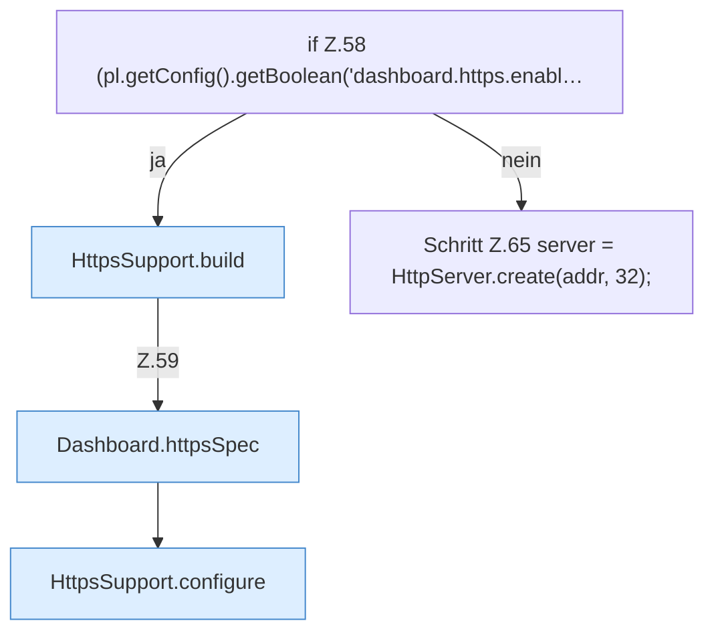

[[00 Start]] › [[Dashboard-HTTP]] › [[HTTP-Start]] › [[Dashboard.start]] › [[Dashboard.start.Teil2.Z58]]

# Dashboard.start.Teil2.Z58



```knoten
if Z.58 (pl.getConfig().getBoolean('dashboard.https.enabl…
  Zeile 58: prüft `(pl.getConfig().getBoolean('dashboard.https.enabl…`.
HttpsSupport.build
  Dieser Teil baut das. Baut `build`. Ruft `fromKeystore`, `ensureSelfSigned`, `password`.
Dashboard.httpsSpec
  Liest, ob und wie die [[Glossar#Verschlüsselung|Verschlüsselung]] eingestellt ist. `httpsSpec` in `Dashboard.java`.
HttpsSupport.configure
  Dieser Teil macht hier einen einzelnen Schritt. Eine Ebene tiefer steht er genauer. `configure` in `HttpsSupport.java`. Ruft `configure`.
Schritt Z.65 server = HttpServer.create(addr, 32);
  Zeile 65: betrifft den HTTP-Server. `server = HttpServer.create(addr, 32);`
```

> [!knoten]- Was die Blöcke tun
> - **if Z.58 (pl.getConfig().getBoolean('dashboard.https.enabl…**: Zeile 58: prüft `(pl.getConfig().getBoolean('dashboard.https.enabl…`.
> - **HttpsSupport.build**: Dieser Teil baut das. Baut `build`. Ruft `fromKeystore`, `ensureSelfSigned`, `password`.
> - **Dashboard.httpsSpec**: Liest, ob und wie die [[Glossar#Verschlüsselung|Verschlüsselung]] eingestellt ist. `httpsSpec` in `Dashboard.java`.
> - **HttpsSupport.configure**: Dieser Teil macht hier einen einzelnen Schritt. Eine Ebene tiefer steht er genauer. `configure` in `HttpsSupport.java`. Ruft `configure`.
> - **Schritt Z.65 server = HttpServer.create(addr, 32);**: Zeile 65: betrifft den HTTP-Server. `server = HttpServer.create(addr, 32);`

- Der Ablauf geht in [[Glossar#Zeile|Zeile]] 58 weiter. Eine Ebene tiefer steht er genauer.
- Fortsetzung von `Dashboard.start.Teil2`.
