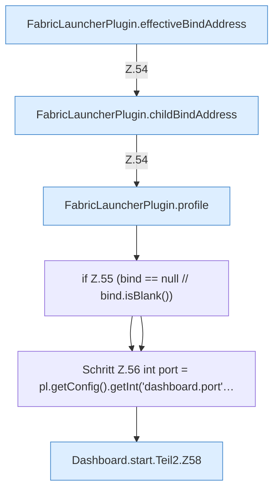

[[00 Start]] › [[Dashboard-HTTP]] › [[HTTP-Start]] › [[Dashboard.start]] › [[Dashboard.start.Teil2]]

# Dashboard.start.Teil2



```knoten
FabricLauncherPlugin.effectiveBindAddress
  Liefert den wirksamen Wert `effectiveBindAddress`.
FabricLauncherPlugin.childBindAddress
  Betrifft den Child `childBindAddress`. Ruft `effectiveBindAddress`, `hostBindAddress`.
FabricLauncherPlugin.profile
  `profile` in `FabricLauncherPlugin.java`.
if Z.55 (bind == null // bind.isBlank())
  Zeile 55: prüft `(bind == null // bind.isBlank())`.
Schritt Z.56 int port = pl.getConfig().getInt('dashboard.port'…
  Zeile 56: liest die Config. `int port = pl.getConfig().getInt('dashboard.port'…`
Dashboard.start.Teil2.Z58
  Fortsetzung des Ablaufs ab Zeile 58.
```

- Fortsetzung von `Dashboard.start`, Quellreihenfolge.
