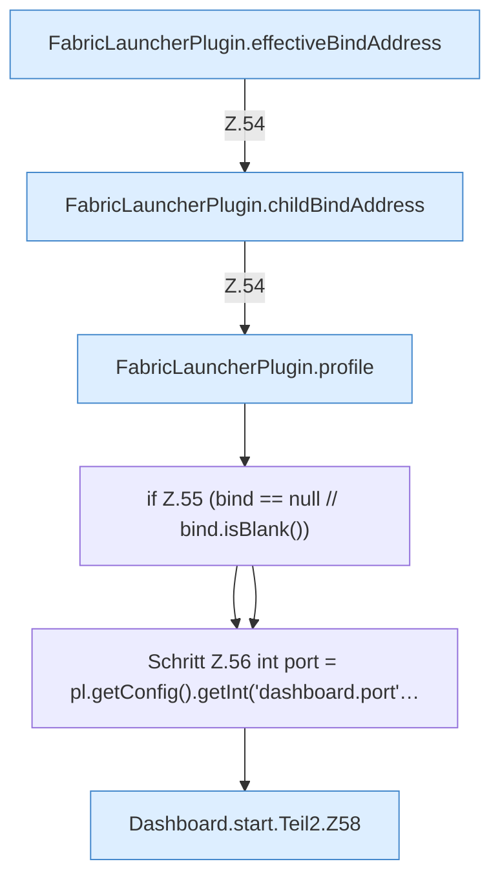

[[00 Start]] › [[Dashboard-HTTP]] › [[HTTP-Start]] › [[Dashboard.start]] › [[Dashboard.start.Teil2]]

# Dashboard.start.Teil2



```knoten
FabricLauncherPlugin.effectiveBindAddress
  Die Adresse, die nach allen Ersatzregeln wirklich gilt. Liefert den wirksamen Wert `effectiveBindAddress`.
FabricLauncherPlugin.childBindAddress
  Die Adresse, unter der der [[Glossar#Spielserver|Spielserver]] erreichbar sein soll. Betrifft den Child `childBindAddress`. Ruft `effectiveBindAddress`, `hostBindAddress`.
FabricLauncherPlugin.profile
  Das [[Glossar#Plugin|Plugin]] macht hier einen einzelnen Schritt. Eine Ebene tiefer steht er genauer. `profile` in `FabricLauncherPlugin.java`.
if Z.55 (bind == null // bind.isBlank())
  Zeile 55: prüft `(bind == null // bind.isBlank())`.
Schritt Z.56 int port = pl.getConfig().getInt('dashboard.port'…
  Zeile 56: liest die Config. `int port = pl.getConfig().getInt('dashboard.port'…`
Dashboard.start.Teil2.Z58
  Der Ablauf geht in [[Glossar#Zeile|Zeile]] 58 weiter. Eine Ebene tiefer steht er genauer. Fortsetzung des Ablaufs ab Zeile 58.
```

> [!knoten]- Was die Blöcke tun
> - **FabricLauncherPlugin.effectiveBindAddress**: Die Adresse, die nach allen Ersatzregeln wirklich gilt. Liefert den wirksamen Wert `effectiveBindAddress`.
> - **FabricLauncherPlugin.childBindAddress**: Die Adresse, unter der der [[Glossar#Spielserver|Spielserver]] erreichbar sein soll. Betrifft den Child `childBindAddress`. Ruft `effectiveBindAddress`, `hostBindAddress`.
> - **FabricLauncherPlugin.profile**: Das [[Glossar#Plugin|Plugin]] macht hier einen einzelnen Schritt. Eine Ebene tiefer steht er genauer. `profile` in `FabricLauncherPlugin.java`.
> - **if Z.55 (bind == null // bind.isBlank())**: Zeile 55: prüft `(bind == null // bind.isBlank())`.
> - **Schritt Z.56 int port = pl.getConfig().getInt('dashboard.port'…**: Zeile 56: liest die Config. `int port = pl.getConfig().getInt('dashboard.port'…`
> - **Dashboard.start.Teil2.Z58**: Der Ablauf geht in [[Glossar#Zeile|Zeile]] 58 weiter. Eine Ebene tiefer steht er genauer. Fortsetzung des Ablaufs ab Zeile 58.

- Ein weiterer Abschnitt derselben Übersicht.
- Fortsetzung von `Dashboard.start`.
