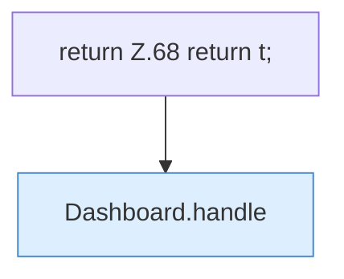

[[00 Start]] › [[Dashboard-HTTP]] › [[HTTP-Start]] › [[Dashboard.start]] › [[Dashboard.start.Teil3]]

# Dashboard.start.Teil3



```knoten
return Z.68 return t;
  Zeile 68: Rückgabe `return t;`.
Dashboard.handle
  Ein HTTP-Kontext `/`, verzweigt nach Methode und Pfad.
```

- Fortsetzung von `Dashboard.start`, Quellreihenfolge.
