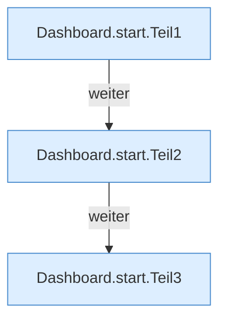

[[00 Start]] › [[Dashboard-HTTP]] › [[HTTP-Start]] › [[Dashboard.start]]

# Dashboard.start

`Dashboard.start()` [src/main/java/de/aichele/childlauncher/Dashboard.java:44–73](https://github.com/Sciddie/minecraft-serverhoster-plugin/blob/95b02b953b0b4c23673e900e021a7c3c844aa37d/src/main/java/de/aichele/childlauncher/Dashboard.java#L44-L73)

- `start` in `src/main/java/de/aichele/childlauncher/Dashboard.java`
