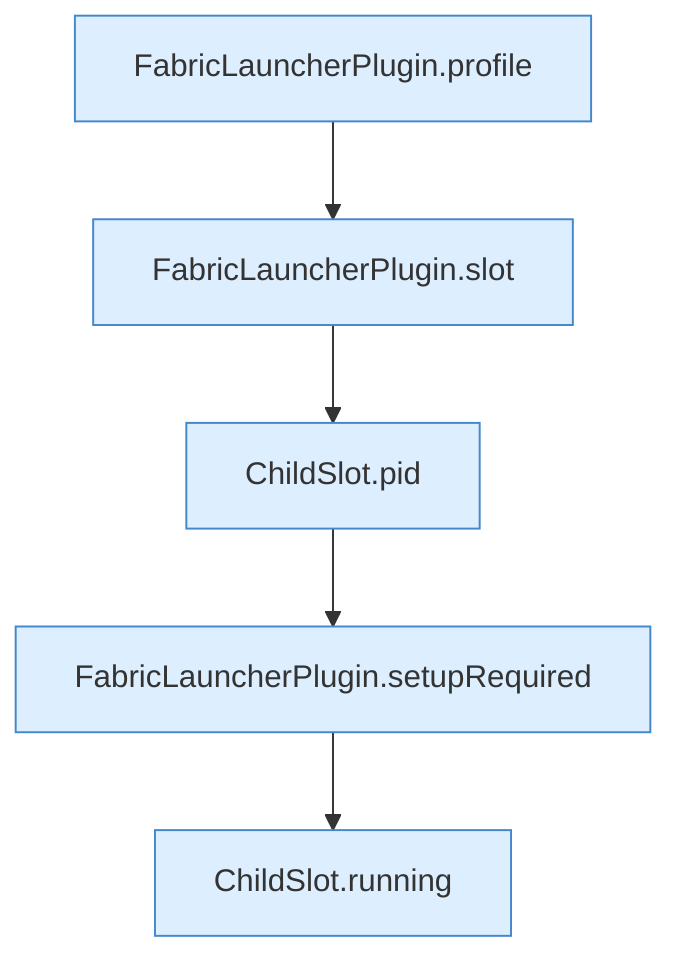

[[00 Start]] › [[Dashboard-HTTP]] › [[API-Status]] › [[Dashboard.status]] › [[Dashboard.status.Teil1]]

# Dashboard.status.Teil1



```knoten
FabricLauncherPlugin.profile
  Das [[Glossar#Plugin|Plugin]] macht hier einen einzelnen Schritt. Eine Ebene tiefer steht er genauer. `profile` in `FabricLauncherPlugin.java`.
FabricLauncherPlugin.slot
  Das [[Glossar#Plugin|Plugin]] macht hier einen einzelnen Schritt. Eine Ebene tiefer steht er genauer. `slot` in `FabricLauncherPlugin.java`. Ruft `profile`, `ChildSlot`.
ChildSlot.pid
  Dieser Teil macht hier einen einzelnen Schritt. Eine Ebene tiefer steht er genauer. Liefert die Prozessnummer `pid`.
FabricLauncherPlugin.setupRequired
  Das [[Glossar#Plugin|Plugin]] kümmert sich um einen Pflichtwert. `setupRequired` in `FabricLauncherPlugin.java`.
ChildSlot.running
  Dieser Teil prüft, ob läuft, das. Sagt, ob der [[Glossar#Prozess|Prozess]] läuft `running`.
```

> [!knoten]- Was die Blöcke tun
> - **FabricLauncherPlugin.profile**: Das [[Glossar#Plugin|Plugin]] macht hier einen einzelnen Schritt. Eine Ebene tiefer steht er genauer. `profile` in `FabricLauncherPlugin.java`.
> - **FabricLauncherPlugin.slot**: Das [[Glossar#Plugin|Plugin]] macht hier einen einzelnen Schritt. Eine Ebene tiefer steht er genauer. `slot` in `FabricLauncherPlugin.java`. Ruft `profile`, `ChildSlot`.
> - **ChildSlot.pid**: Dieser Teil macht hier einen einzelnen Schritt. Eine Ebene tiefer steht er genauer. Liefert die Prozessnummer `pid`.
> - **FabricLauncherPlugin.setupRequired**: Das [[Glossar#Plugin|Plugin]] kümmert sich um einen Pflichtwert. `setupRequired` in `FabricLauncherPlugin.java`.
> - **ChildSlot.running**: Dieser Teil prüft, ob läuft, das. Sagt, ob der [[Glossar#Prozess|Prozess]] läuft `running`.

- Ein weiterer Abschnitt derselben Übersicht.
- Fortsetzung von `Dashboard.status`.
