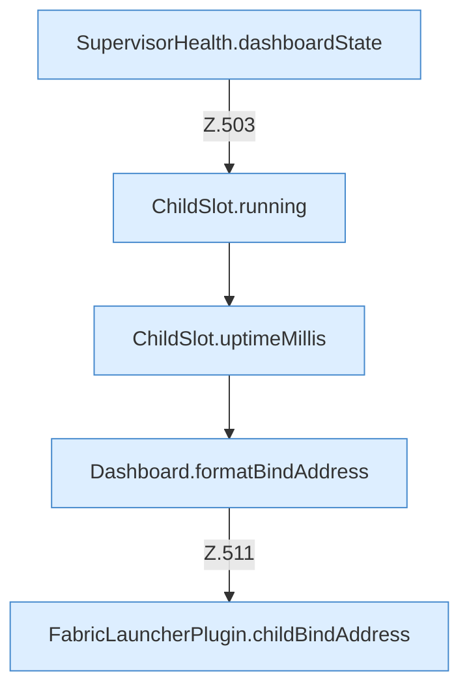

[[00 Start]] › [[Dashboard-HTTP]] › [[API-Status]] › [[Dashboard.status]] › [[Dashboard.status.Teil2]]

# Dashboard.status.Teil2



```knoten
SupervisorHealth.dashboardState
  `dashboardState` in `SupervisorHealth.java`.
ChildSlot.running
  Sagt, ob der Prozess läuft `running`.
ChildSlot.uptimeMillis
  Liefert die Laufzeit `uptimeMillis`. Ruft `running`.
Dashboard.formatBindAddress
  Formatiert `formatBindAddress`.
FabricLauncherPlugin.childBindAddress
  Betrifft den Child `childBindAddress`. Ruft `effectiveBindAddress`, `hostBindAddress`.
```

- Fortsetzung von `Dashboard.status`, Quellreihenfolge.
