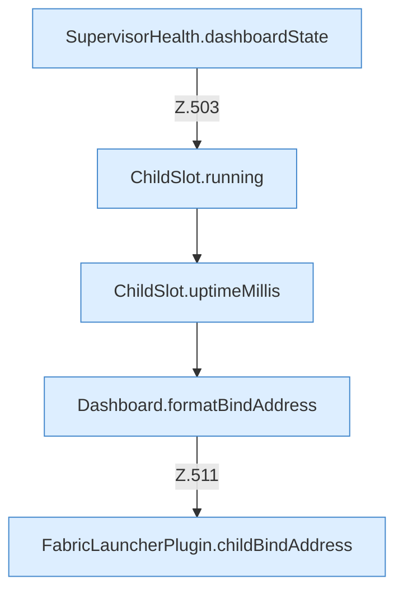

[[00 Start]] › [[Dashboard-HTTP]] › [[API-Status]] › [[Dashboard.status]] › [[Dashboard.status.Teil2]]

# Dashboard.status.Teil2



```knoten
SupervisorHealth.dashboardState
  Dieser Teil kümmert sich um den Zustand. `dashboardState` in `SupervisorHealth.java`.
ChildSlot.running
  Dieser Teil prüft, ob läuft, das. Sagt, ob der [[Glossar#Prozess|Prozess]] läuft `running`.
ChildSlot.uptimeMillis
  Dieser Teil kümmert sich um die Zeit. Liefert die Laufzeit `uptimeMillis`. Ruft `running`.
Dashboard.formatBindAddress
  Die [[Glossar#Web-Schnittstelle|Web-Schnittstelle]] macht lesbar die Bindung die Adresse. Formatiert `formatBindAddress`.
FabricLauncherPlugin.childBindAddress
  Die Adresse, unter der der [[Glossar#Spielserver|Spielserver]] erreichbar sein soll. Betrifft den Child `childBindAddress`. Ruft `effectiveBindAddress`, `hostBindAddress`.
```

> [!knoten]- Was die Blöcke tun
> - **SupervisorHealth.dashboardState**: Dieser Teil kümmert sich um den Zustand. `dashboardState` in `SupervisorHealth.java`.
> - **ChildSlot.running**: Dieser Teil prüft, ob läuft, das. Sagt, ob der [[Glossar#Prozess|Prozess]] läuft `running`.
> - **ChildSlot.uptimeMillis**: Dieser Teil kümmert sich um die Zeit. Liefert die Laufzeit `uptimeMillis`. Ruft `running`.
> - **Dashboard.formatBindAddress**: Die [[Glossar#Web-Schnittstelle|Web-Schnittstelle]] macht lesbar die Bindung die Adresse. Formatiert `formatBindAddress`.
> - **FabricLauncherPlugin.childBindAddress**: Die Adresse, unter der der [[Glossar#Spielserver|Spielserver]] erreichbar sein soll. Betrifft den Child `childBindAddress`. Ruft `effectiveBindAddress`, `hostBindAddress`.

- Ein weiterer Abschnitt derselben Übersicht.
- Fortsetzung von `Dashboard.status`.
