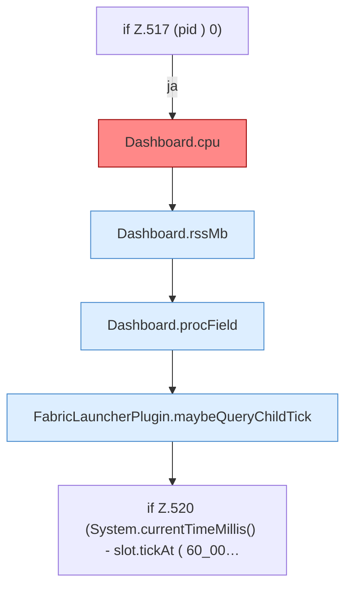

[[00 Start]] › [[Dashboard-HTTP]] › [[API-Status]] › [[Dashboard.status]] › [[Dashboard.status.Teil3.Z517]]

# Dashboard.status.Teil3.Z517

- Fortsetzung von `Dashboard.status.Teil3`, Quellreihenfolge.
