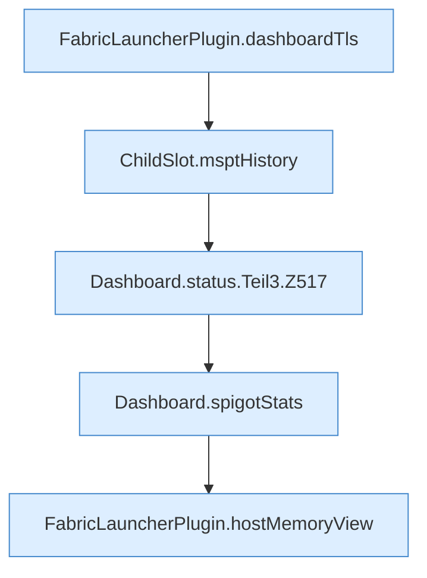

[[00 Start]] › [[Dashboard-HTTP]] › [[API-Status]] › [[Dashboard.status]] › [[Dashboard.status.Teil3]]

# Dashboard.status.Teil3



```knoten
FabricLauncherPlugin.dashboardTls
  `dashboardTls` in `FabricLauncherPlugin.java`. Ruft `tls`.
ChildSlot.msptHistory
  Liefert die Tickzeiten `msptHistory`.
Dashboard.status.Teil3.Z517
  Fortsetzung des Ablaufs ab Zeile 517.
Dashboard.spigotStats
  `spigotStats` in `Dashboard.java`. Ruft `rssMb`.
FabricLauncherPlugin.hostMemoryView
  Betrifft den Host `hostMemoryView`. Ruft `view`, `cgroupUsePercent`, `emergencyStopStarted`.
```

- Fortsetzung von `Dashboard.status`, Quellreihenfolge.
