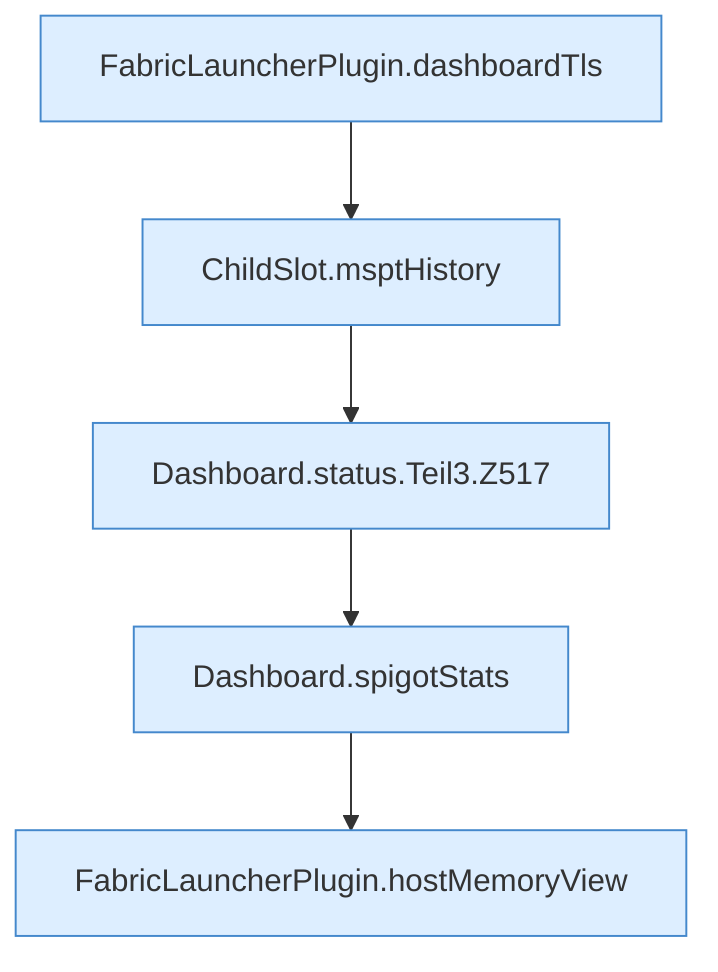

[[00 Start]] › [[Dashboard-HTTP]] › [[API-Status]] › [[Dashboard.status]] › [[Dashboard.status.Teil3]]

# Dashboard.status.Teil3



```knoten
FabricLauncherPlugin.dashboardTls
  Liest, ob die [[Glossar#Bedienseite|Bedienseite]] verschlüsselt erreichbar sein soll. `dashboardTls` in `FabricLauncherPlugin.java`. Ruft `tls`.
ChildSlot.msptHistory
  Dieser Teil kümmert sich um den Verlauf. Liefert die Tickzeiten `msptHistory`.
Dashboard.status.Teil3.Z517
  Der Ablauf geht in [[Glossar#Zeile|Zeile]] 517 weiter. Eine Ebene tiefer steht er genauer. Fortsetzung des Ablaufs ab Zeile 517.
Dashboard.spigotStats
  Liefert eine kurze Statistik, die der [[Glossar#Spielserver|Spielserver]] anbietet. `spigotStats` in `Dashboard.java`. Ruft `rssMb`.
FabricLauncherPlugin.hostMemoryView
  Stellt die Speichermessung so zusammen, wie die [[Glossar#Bedienseite|Bedienseite]] sie zeigt. Betrifft den [[Glossar#Host|Host]] `hostMemoryView`. Ruft `view`, `cgroupUsePercent`, `emergencyStopStarted`.
```

> [!knoten]- Was die Blöcke tun
> - **FabricLauncherPlugin.dashboardTls**: Liest, ob die [[Glossar#Bedienseite|Bedienseite]] verschlüsselt erreichbar sein soll. `dashboardTls` in `FabricLauncherPlugin.java`. Ruft `tls`.
> - **ChildSlot.msptHistory**: Dieser Teil kümmert sich um den Verlauf. Liefert die Tickzeiten `msptHistory`.
> - **Dashboard.status.Teil3.Z517**: Der Ablauf geht in [[Glossar#Zeile|Zeile]] 517 weiter. Eine Ebene tiefer steht er genauer. Fortsetzung des Ablaufs ab Zeile 517.
> - **Dashboard.spigotStats**: Liefert eine kurze Statistik, die der [[Glossar#Spielserver|Spielserver]] anbietet. `spigotStats` in `Dashboard.java`. Ruft `rssMb`.
> - **FabricLauncherPlugin.hostMemoryView**: Stellt die Speichermessung so zusammen, wie die [[Glossar#Bedienseite|Bedienseite]] sie zeigt. Betrifft den [[Glossar#Host|Host]] `hostMemoryView`. Ruft `view`, `cgroupUsePercent`, `emergencyStopStarted`.

- Ein weiterer Abschnitt derselben Übersicht.
- Fortsetzung von `Dashboard.status`.
