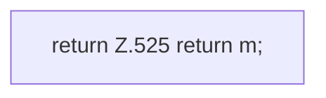

[[00 Start]] › [[Dashboard-HTTP]] › [[API-Status]] › [[Dashboard.status]] › [[Dashboard.status.Teil4]]

# Dashboard.status.Teil4



```knoten
return Z.525 return m;
  Zeile 525: Rückgabe `return m;`.
```

> [!knoten]- Was die Blöcke tun
> - **return Z.525 return m;**: Zeile 525: Rückgabe `return m;`.

- Ein weiterer Abschnitt derselben Übersicht.
- Fortsetzung von `Dashboard.status`.
