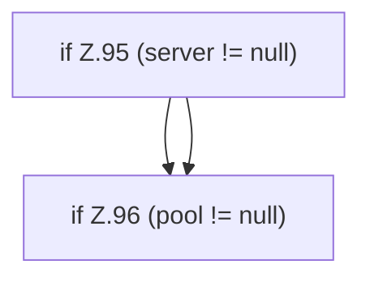

[[00 Start]] › [[Dashboard-HTTP]] › [[HTTP-Start]] › [[Dashboard.stop]]

# Dashboard.stop

`Dashboard.stop()` [src/main/java/de/aichele/childlauncher/Dashboard.java:94–97](https://github.com/Sciddie/minecraft-serverhoster-plugin/blob/95b02b953b0b4c23673e900e021a7c3c844aa37d/src/main/java/de/aichele/childlauncher/Dashboard.java#L94-L97)

- `stop` in `src/main/java/de/aichele/childlauncher/Dashboard.java`
