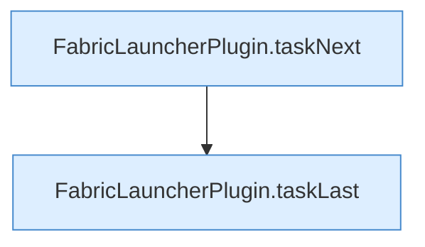

[[00 Start]] › [[Dashboard-HTTP]] › [[API-Zeit]] › [[Dashboard.taskJson]] › [[Dashboard.taskJson.Teil1]]

# Dashboard.taskJson.Teil1



```knoten
FabricLauncherPlugin.taskNext
  Rechnet, wann eine [[Glossar#Aufgabe|Aufgabe]] das nächste Mal laufen soll. `taskNext` in `FabricLauncherPlugin.java`. Ruft `next`.
FabricLauncherPlugin.taskLast
  Merkt, wann eine [[Glossar#Aufgabe|Aufgabe]] zuletzt gelaufen ist. `taskLast` in `FabricLauncherPlugin.java`.
```

> [!knoten]- Was die Blöcke tun
> - **FabricLauncherPlugin.taskNext**: Rechnet, wann eine [[Glossar#Aufgabe|Aufgabe]] das nächste Mal laufen soll. `taskNext` in `FabricLauncherPlugin.java`. Ruft `next`.
> - **FabricLauncherPlugin.taskLast**: Merkt, wann eine [[Glossar#Aufgabe|Aufgabe]] zuletzt gelaufen ist. `taskLast` in `FabricLauncherPlugin.java`.

- Ein weiterer Abschnitt derselben Übersicht.
- Fortsetzung von `Dashboard.taskJson`.
