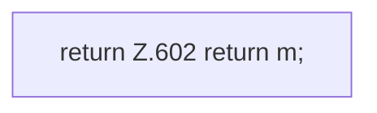

[[00 Start]] › [[Dashboard-HTTP]] › [[API-Zeit]] › [[Dashboard.taskJson]] › [[Dashboard.taskJson.Teil2]]

# Dashboard.taskJson.Teil2



```knoten
return Z.602 return m;
  Zeile 602: Rückgabe `return m;`.
```

- Fortsetzung von `Dashboard.taskJson`, Quellreihenfolge.
