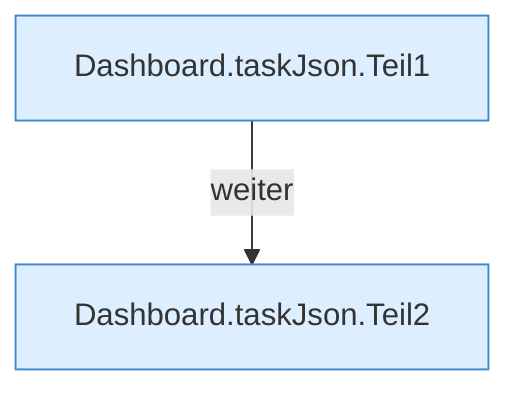

[[00 Start]] › [[Dashboard-HTTP]] › [[API-Zeit]] › [[Dashboard.taskJson]]

# Dashboard.taskJson

`Dashboard.taskJson(TaskDef t)` [src/main/java/de/aichele/childlauncher/Dashboard.java:597–603](https://github.com/Sciddie/minecraft-serverhoster-plugin/blob/95b02b953b0b4c23673e900e021a7c3c844aa37d/src/main/java/de/aichele/childlauncher/Dashboard.java#L597-L603)

- `taskJson` in `src/main/java/de/aichele/childlauncher/Dashboard.java`
