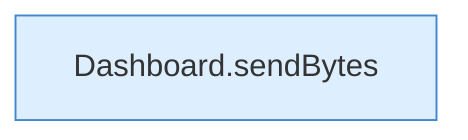

[[00 Start]] › [[Dashboard-HTTP]] › [[API-Antworten]] › [[Dashboard.text]]

# Dashboard.text

`Dashboard.text(HttpExchange ex, String s)` [src/main/java/de/aichele/childlauncher/Dashboard.java:997–997](https://github.com/Sciddie/minecraft-serverhoster-plugin/blob/95b02b953b0b4c23673e900e021a7c3c844aa37d/src/main/java/de/aichele/childlauncher/Dashboard.java#L997-L997)



```knoten
Dashboard.sendBytes
  Die [[Glossar#Web-Schnittstelle|Web-Schnittstelle]] schickt die Größe. Im [[Glossar#Quelltext|Quelltext]] heißt das `sendBytes`.
```

> [!knoten]- Was die Blöcke tun
> - **Dashboard.sendBytes**: Die [[Glossar#Web-Schnittstelle|Web-Schnittstelle]] schickt die Größe. Im [[Glossar#Quelltext|Quelltext]] heißt das `sendBytes`.

- Die [[Glossar#Web-Schnittstelle|Web-Schnittstelle]] macht hier einen einzelnen Schritt. Eine Ebene tiefer steht er genauer.
