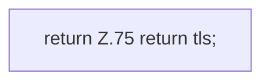

[[00 Start]] › [[Dashboard-HTTP]] › [[HTTP-Start]] › [[Dashboard.tls]]

# Dashboard.tls

`Dashboard.tls()` [src/main/java/de/aichele/childlauncher/Dashboard.java:75–75](https://github.com/Sciddie/minecraft-serverhoster-plugin/blob/95b02b953b0b4c23673e900e021a7c3c844aa37d/src/main/java/de/aichele/childlauncher/Dashboard.java#L75-L75)



```knoten
return Z.75 return tls;
  Hier endet die [[Glossar#Funktion|Funktion]] und liefert ein Ergebnis zurück. Das steht in [[Glossar#Zeile|Zeile]] 75.
```

> [!knoten]- Was die Blöcke tun
> - **return Z.75 return tls;**: Hier endet die [[Glossar#Funktion|Funktion]] und liefert ein Ergebnis zurück. Das steht in [[Glossar#Zeile|Zeile]] 75.

- Liest, ob die Verbindung zur [[Glossar#Bedienseite|Bedienseite]] verschlüsselt sein soll.
