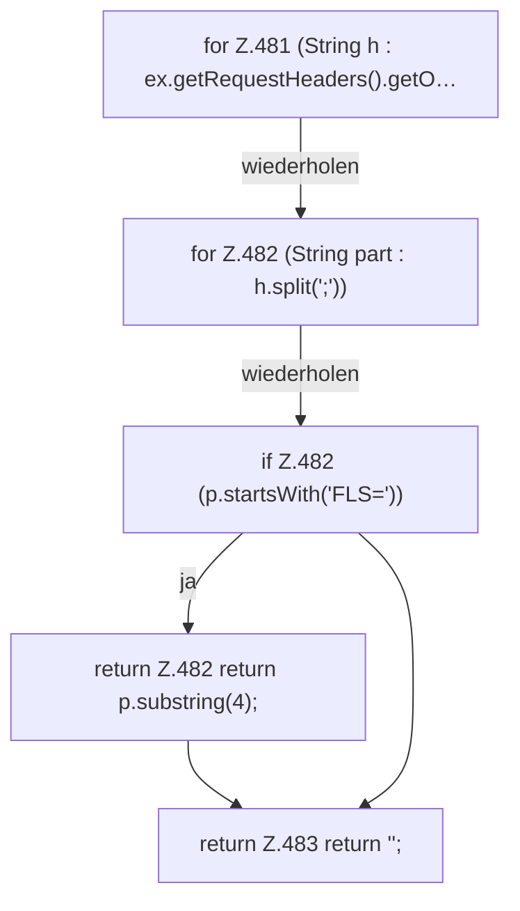

[[00 Start]] › [[Dashboard-HTTP]] › [[HTTP-Auth]] › [[Dashboard.token]]

# Dashboard.token

`Dashboard.token(HttpExchange ex)` [src/main/java/de/aichele/childlauncher/Dashboard.java:480–484](https://github.com/Sciddie/minecraft-serverhoster-plugin/blob/95b02b953b0b4c23673e900e021a7c3c844aa37d/src/main/java/de/aichele/childlauncher/Dashboard.java#L480-L484)



```knoten
for Z.481 (String h : ex.getRequestHeaders().getO…
  Zeile 481: Schleife `(String h : ex.getRequestHeaders().getO…`.
for Z.482 (String part : h.split(';'))
  Zeile 482: Schleife `(String part : h.split(';'))`.
if Z.482 (p.startsWith('FLS='))
  Zeile 482: prüft `(p.startsWith('FLS='))`.
return Z.482 return p.substring(4);
  Zeile 482: Rückgabe `return p.substring(4);`.
return Z.483 return '';
  Zeile 483: Rückgabe `return '';`.
```

- `token` in `src/main/java/de/aichele/childlauncher/Dashboard.java`
